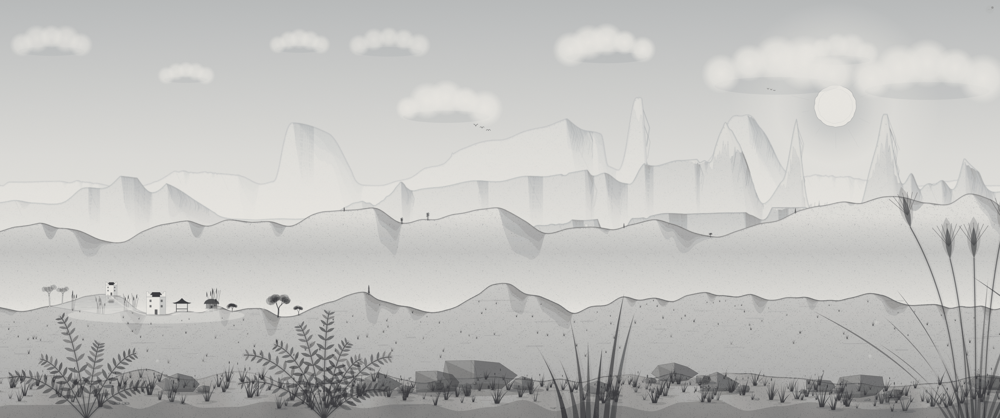
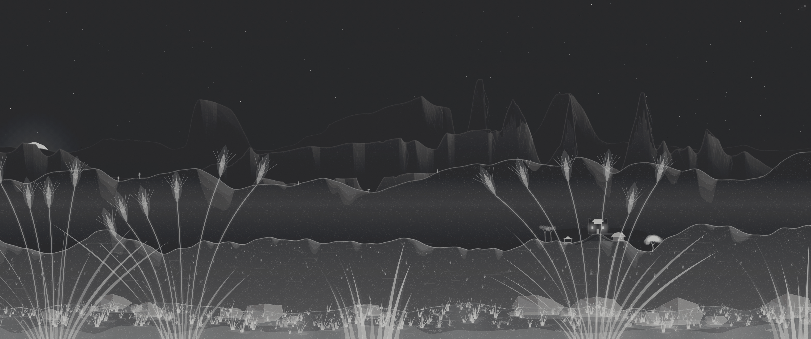

<h1 align="center">Nijimi</h1>

<p align="center"><em>Walk through a watercolor that paints itself.</em></p>

<p align="center"><sub><b>nijimi</b> (滲み) · Japanese · the bleed of ink or color into wet paper</sub></p>

<p align="center">
  
  
  
</p>





An endless ink-and-wash landscape that draws itself as you scroll: mountains, lakes, forests, villages, weather and a full day–night cycle, generated live on one canvas. Nothing is pre-drawn and nothing is stored. No dependencies, no build step.

**[Live demo](https://mosaddiqdev.github.io/nijimi/)** · **Try it:** open `index.html` and scroll.

## Why it's different

- **It is a world, not a loop.** Every plane reads the same climate, so a wet valley grows reeds, lakes and leafy trees while dry high ground goes bare, and the weather follows the terrain.
- **It looks painted, not rendered.** Graded washes, pigment pooling at the edges, paper-grain granulation, and brush lines that fade in and out like a real dry brush.
- **Scrolling is walking.** The page scroll is the only input, and scrolling back retraces exactly the same scenery — the whole world is a pure function of position and a seed.

## Features

- Endless world: scroll to walk, scroll back to retrace exactly the same scenery.
- Six parallax planes, from pale distant ranges to charcoal foreground grass, each with its own pencil weight and wash.
- One shared climate (altitude, wetness, forest density) read by every plane, so mountains, foothills, trees, lakes and villages all agree.
- Watercolor effects: graded washes, dry-brush edges, pigment pooling along outlines, paper-grain granulation, snow caps left as bare paper.
- Four house types, pagodas, boats, waterfalls and lake reflections.
- Day and night cycle with sunrise and sunset color, a moon, stars and lit windows. Night inverts the drawing to chalk on charcoal.
- Weather: fog, rain with lightning, and snow, driven by noise so it shifts as you walk.
- Ambient life: pollen, fireflies, falling leaves, birds, drifting clouds and chimney smoke.
- Auto-walk (three speeds), three depth levels, new random landscape, distance odometer and PNG screenshots.
- Respects `prefers-reduced-motion` — starts flat with no ambient motion.

## Run locally

It's a static site. Open `index.html` directly in a browser, or serve the folder:

```bash
python3 -m http.server 8000
# visit http://localhost:8000
```

## Controls

| Input | Action |
| --- | --- |
| Scroll / swipe / arrow keys | Walk through the landscape |
| `W` | Toggle auto-walk |
| `N` | New landscape |
| `S` | Save a PNG screenshot |
| `H` | Hide or show controls (tap top-right to bring them back) |
| `U` | Cycle odometer units: km, miles, steps, time on foot |
| `D` | Cycle depth: Flat, Gentle, Full |
| `L` | Cycle lighting: Day, Auto, Night |
| `Esc` | Close the menu |

The menu (top right) also sets walking speed: Slow, Steady, Brisk. Units and depth are remembered in `localStorage`.

## How it works

- **Deterministic world.** Everything is a pure function of world position and a seed (`Hh` is an integer hash, `vn` and `fbm` are value noise on top). Nothing is stored — scrolling back is lossless, and a new landscape is just a new seed.
- **Chunked cache.** Each plane is split into 480 px chunks painted once to offscreen canvases. Visible chunks are built on demand under a per-frame time budget, upcoming chunks are prebuilt in the direction of travel, and old ones are recycled or freed.
- **Depth.** The speed spread between planes is squeezed geometrically toward one pivot speed — that's what Flat, Gentle, and Full change.
- **Per-frame layers.** Sky, sun and moon, clouds, birds, smoke, particles, lake reflections, weather and the night inversion are drawn live each frame on top of the cached chunks.
- **Memory safety.** If the browser refuses a new canvas (common on iOS Safari), everything is released and rebuilt at slightly lower quality.

## Tuning

All constants live in `js/main.js`.

| What | Where |
| --- | --- |
| Paper grain strength per plane | `GR` |
| Pigment pooling along outlines | `EDG` |
| How often forests appear | `sm(.58,.8,…)` inside `fcov()` |
| How dense the trees are | `p0=[0,0,0,.55,.36,.15]` inside `build()` |
| Length of one day, in metres walked | `CYCLE` |
| Parallax speed of each plane | `SP` |
| Default auto-walk speed (px/s) | `spd` |
| Gaps in the brush line | `sm(.3,.52,…)` inside `pen()` |
| Sunrise and sunset color strength | the `.3` and `.14` alphas near `var wm=` in `sky()` |

## Project structure

```
nijimi/
├── index.html          page markup and UI
├── css/style.css       styles
├── js/main.js          the whole generator (single IIFE)
├── favicon.svg
├── screenshots/        images used by this README
├── .github/workflows/pages.yml   syntax check and GitHub Pages deploy
├── LICENSE
└── README.md
```

## Deploy

The repo deploys automatically to GitHub Pages on every push to `main` via the included workflow (`.github/workflows/pages.yml`). It runs a syntax check on `js/main.js` first, then publishes the site.

Live at **[mosaddiqdev.github.io/nijimi](https://mosaddiqdev.github.io/nijimi/)**.

## Browser support

Any current evergreen browser with Canvas 2D and modern CSS (`color-mix`, `backdrop-filter`). Fonts (DM Sans, Instrument Serif) load from Google Fonts and fall back to system fonts if offline.

## Performance notes

Heavy work happens once per cached chunk, not per frame, and the loop drops to half rate when nothing is moving. On very high-DPI screens the canvas resolution is capped at 1.5×. If scrolling stutters on a low-end device, set depth to Flat.

## Related work

Procedural, infinitely scrolling landscape painting has a well-known predecessor in [{Shan, Shui}\*](https://github.com/LingDong-/shan-shui-inf) by Lingdong Huang, which generates Chinese landscape scrolls as SVG. Nijimi is an independent implementation with a different rendering approach — live canvas, watercolor washes, and a shared climate model.

## License

[MIT](LICENSE) © mosaddiqdev
